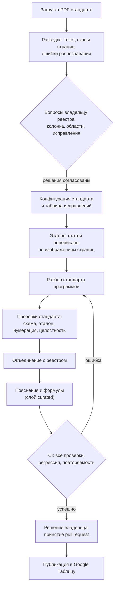

# Реестр биометрических метрик из ГОСТов

Реестр терминов и метрик биометрии (FMR, FNMR, FAR, FRR и др.), сформированный на основе национальных стандартов.
Для каждой метрики приводятся дословные формулировки всех стандартов, в которых она определена, пояснение для неспециалиста и формула расчёта.

Актуальная версия реестра опубликована в [Google Таблице](https://docs.google.com/spreadsheets/d/1FJ7YqoUL4OeHF_aONszUVQFVKlGMuOboZQGGx2sjFwk/edit?gid=1#gid=1) (только для чтения).
Источником данных является данный репозиторий; таблица обновляется автоматически.

## Принцип работы

Формулировки стандартов извлекаются детерминированной программой. Языковая модель (агент) не формирует и не изменяет текст стандартов:
она выполняет подключение новых документов под контролем владельца реестра и подготавливает пояснения в отдельном слое данных.
Каждый этап завершается автоматическими проверками.



## Контроль достоверности

| Гарантия | Способ проверки |
|---|---|
| Формулировки соответствуют тексту PDF | Разбор выполняет программа; каждое изменение текста (склейка переноса, исправление распознавания) фиксируется в журнале |
| Исправления распознавания обоснованы | Каждое исправление внесено в конфигурацию стандарта с указанием фрагмента скана; перечень утверждается владельцем реестра |
| Разбор выполнен корректно | **Эталон:** статьи каждого стандарта переписаны по изображениям страниц и при каждом прогоне сверяются с результатом разбора посимвольно |
| Изменения не затрагивают ранее подключённые стандарты | **Регрессия:** результат каждого стандарта побайтно сравнивается с утверждённой копией |
| Данные соответствуют структуре реестра | **Схема:** каждое значение проверяется по ограничениям своей колонки; тип, статус и область — только из справочников |
| Статьи извлечены полностью и не смешаны | Нумерация без пропусков; в определениях отсутствуют обрывы и чужие номера; при наличии алфавитного указателя термины сверяются с ним |
| Объединение стандартов прозрачно | Объединяются только записи с одинаковой аббревиатурой и областью; любое расхождение отмечается флагом и отражается в отчёте |
| Пояснения соответствуют источникам | Пояснения хранятся отдельно (`data/curated/`) с отпечатком формулировок источников; при их изменении ставится флаг `llm_stale`. Формулы проверяются подстановкой значений: все части равенства должны совпадать |
| Утверждение выполняет человек | Программа присваивает только статусы «черновик» и «отложено»; статус «утвержден» допускается только из файла, изменённого владельцем |
| Результат воспроизводим | Повторный прогон даёт побайтно идентичные файлы |
| Публикуются только проверенные данные | Изменения вносятся через pull request; публикация выполняется только после успешного прохождения проверок CI |

При подключении нового стандарта агент проводит разведку и приостанавливает работу до получения решений владельца реестра.
Сведения, которые невозможно извлечь из документа, не заполняются: в поле указывается «—», запись отмечается флагом.

## Подключённые стандарты

<!-- AUTO:standards -->
| Стандарт | Статей | Метрик | Эталон по сканам | Подключён |
|---|---|---|---|---|
| ГОСТ ISO/IEC 2382-37-2016 | 120 | 4 | 6 статей / 72 поля | 2026-10-13 |
| ГОСТ Р 58624.4-2025 (ИСО/МЭК 30107-4) | 5 | 1 | 3 статьи / 36 полей | 2026-10-13 |
| ГОСТ Р 71414.1-2024 (ИСО/МЭК 19795-1) | 35 | 8 | 6 статей / 72 поля | 2026-10-13 |
| ГОСТ Р 58624.1-2019 (ИСО/МЭК 30107-1) | 7 | 0 | 5 статей / 60 полей | 2026-10-13 |
<!-- /AUTO:standards -->

## Порядок работы

Все операции выполняются в веб-интерфейсе GitHub.

| Задача | Действия |
|---|---|
| Подключить стандарт | Загрузить PDF в `data/raw` (**Add file → Upload files**); создать задачу по шаблону «Добавить ГОСТ» и указать имя файла |
| Подготовить пояснения | Создать задачу по шаблону «Сгенерировать тексты» |
| Проверить реестр | Создать задачу по шаблону «Проверить всё» |
| Ответить агенту | Комментарий, начинающийся с `@claude`: в задаче до появления pull request, далее — только в pull request |
| Принять изменения | В pull request дождаться успешного завершения проверок и выполнить **Merge pull request** |
| Утвердить метрику | Добавить строку `Статус: утвержден` в файл `data/curated/<id>.yaml` через **Edit this file → Propose changes** и принять pull request |
| Получить реестр | `data/out/registry.csv` → **Download raw file**; повторная публикация таблицы — **Actions → CI → Run workflow** |

## Для разработчиков

```bash
python3.12 -m venv .venv && .venv/bin/pip install -r requirements.txt
.venv/bin/python run.py          # полный прогон: стандарты, объединение, пояснения, README
.venv/bin/python -m pytest -q    # все проверки
```

- **Правила работы:** [`docs/RULES.md`](docs/RULES.md) — инструменты, согласованные решения, порядок проверок. Задания агенту — `prompts/add_gost.md`, `prompts/generate_fields.md`.
- **Структура реестра:** `config/registry_schema.yaml`; настройки стандарта — `config/<std_id>.yaml`; перечень стандартов — `config/merge.yaml`.
- **Отчёты:** `data/out/<std_id>/report.md` (стандарт), `data/out/merge_report.md` (объединение); утверждённые копии — `data/out/_baseline/`.

<details>
<summary><sub>Флаги — служебные пометки записей</sub></summary>

<!-- AUTO:flags -->
| Флаг | Когда ставится | Что с ним делать |
|---|---|---|
| `header_unparsed` | Заголовок статьи не разобран; сырой текст сохранён | Разобрать заголовок вручную; при необходимости добавить ключ в конфиг стандарта |
| `type_conflict` | Выполнен только один из признаков метрики (А или Б) — на ручной разбор | Решить вручную, метрика это или термин |
| `area_missing` | Нет соответствия «раздел → Область» в конфиге стандарта | Добавить раздел в «раздел → Область» конфига стандарта |
| `id_collision` | id совпал с уже выданным; добавлен суффикс | Проверить, не дубль ли это; при объединении id берётся из первой по priority записи |
| `no_pair` | У метрики не найдена парная метрика | Ничего, если пары у метрики действительно нет; иначе — новое правило pairs по согласованию |
| `ocr_suspect` | Кириллица в латинском поле или латиница в кириллическом — возможная ошибка распознавания | Сверить со сканом; ошибку распознавания добавить в таблицу corrections конфига |
| `ocr_fixed` | Применено исправление ошибки распознавания из таблицы конфига | Ничего — исправление записано в журнал очистки с основанием |
| `key_duplicate` | Ключ совпадает с ключом другой записи; при объединении записи сольются в одну строку | Ничего — записи сольются в одну строку общего реестра |
| `synonym_clash` | Синоним совпадает с наименованием или синонимом другой записи; синоним не удалён | Проверить, не перепутаны ли термины; синоним не удаляется |
| `id_truncated` | Slug из Наименования en длиннее 40 символов; обрезан по границе слова | Ничего — id обрезан по правилу схемы |
| `area_conflict` | Объединение — Аббревиатура en совпала, Область разная; записи не объединены | Решить, какая область верна, и поправить конфиг стандарта |
| `merge_candidate` | Объединение — Наименование en совпало, аббревиатура или область разные; записи не объединены | Решить, одна ли это метрика; при необходимости поправить область или аббревиатуру |
| `name_conflict` | Объединение — наименование другого источника отличается; оно добавлено в «Синонимы» | Ничего — другое наименование сохранено в «Синонимах» |
| `llm_stale` | Формулировки источников изменились после генерации текстов (отпечаток в curated-файле не совпал или отсутствует) — тексты нужно перегенерировать | Перегенерировать тексты (issue «Сгенерировать тексты») |
| `curated_orphan` | Curated-файл ссылается на id, которого нет в общем реестре — файл нужно переименовать или удалить | Переименовать curated-файл под новый id или удалить его |
| `formula_na` | Метрику нельзя выразить через TP, FP, TN, FN — формула «—» | Ничего — формулы у метрики нет |
| `llm_failed` | Генерация текстов не прошла проверку схемы за две попытки — поля «—», причина в отчёте PR | Написать тексты вручную в curated-файле или перезапустить генерацию |
| `hyphen_guess` | Перенос дефисом в наименовании, аббревиатуре или определении угадан — слова нет в тексте стандарта ни с дефисом, ни слитно | Сверить слово со сканом |
<!-- /AUTO:flags -->

</details>
